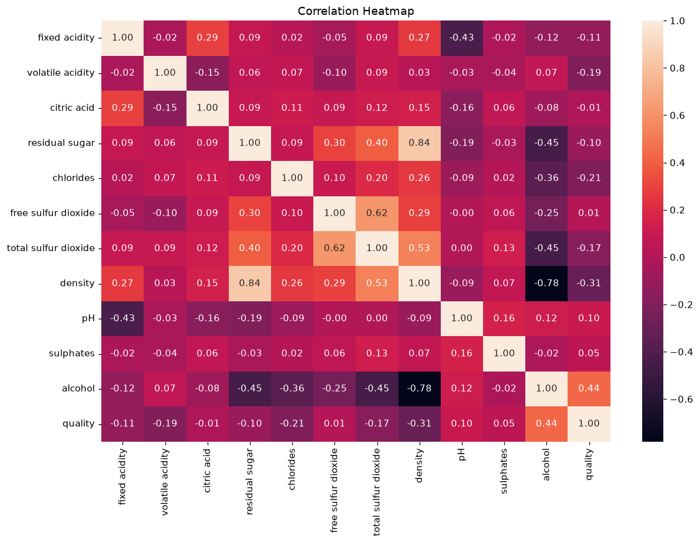
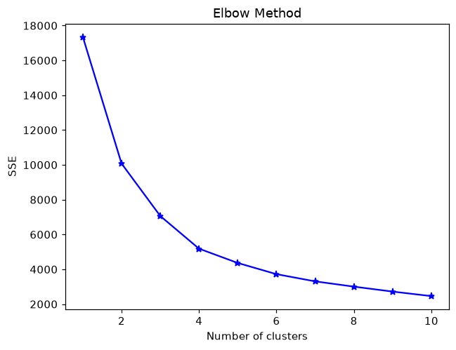

# Wine Quality Prediction and Retail Customer Segmentation

Individual academic project · Ngee Ann Polytechnic · Machine Learning 1 · Semester 3 folder, April 2026 coursework

Two studies apply Python machine learning to product quality and customer behaviour. They demonstrate model evaluation and business interpretation relevant to analytics internships; they are not finance models or work for an employer.

## Business problems

**Wine quality:** estimate white-wine quality scores from physicochemical measurements to explore data-assisted quality assessment.

**Retail segmentation:** group customers by purchasing behaviour so a business can consider retention and marketing priorities.

## Methodology and tools

- Wine: explore 4,898 records, split training and test data, fit IQR capping on training data, apply selected Yeo–Johnson transformations and scaling, and compare linear regression, KNN and decision trees. Tune the tree using GridSearchCV.
- Retail: remove invalid transactions, missing customer IDs, cancellations and returns; aggregate customer-level recency, frequency, monetary value and average basket value; transform and scale features; compare K-means and average-linkage hierarchical clustering using silhouette scores and business interpretation.
- Python, pandas, NumPy, matplotlib, seaborn, scikit-learn, SciPy, feature-engine and statsmodels.

## Key findings from the submitted report

| Model / approach | Reported result | Interpretation |
| --- | --- | --- |
| KNN wine regressor | Test RMSE 0.714; R² 0.341 | Best reported test prediction, with a larger train/test gap |
| Tuned decision tree | Test RMSE 0.725; R² 0.322 | Selected in the submission for interpretability and generalisation |
| K-means, four groups | Silhouette 0.409 | Preferred for more actionable customer groups |
| Hierarchical, two groups | Silhouette 0.448 | Better silhouette, but coarser segmentation |

These are historical submission metrics, not newly improved results. See [the report text](reports/submitted-report.md) for the original discussion.

## Files and reproduction

- [analysis.ipynb](analysis.ipynb): original analysis with template headers, stored outputs and execution metadata removed. One relative path was normalised from `Data` to `data`; modelling code was preserved.
- [requirements.txt](requirements.txt): complete direct imports and JupyterLab.
- `reports/`: original report narrative in a privacy-cleaned text edition.
- `docs/VALIDATION.md`: what was actually checked and any execution failures.

```bash
python -m venv .venv
# Windows PowerShell:
.venv\Scripts\Activate.ps1
python -m pip install -r requirements.txt
python -m jupyterlab
```

Start JupyterLab from this repository and open `analysis.ipynb`. Provide the original course files at `data/winequality-white.csv` and `data/online_retail.csv`. Use the supplied course CSV format rather than silently substituting a differently delimited download. Raw retail data contains customer identifiers; it is excluded from Git and was used only in a local validation copy. Dataset redistribution rights have not been established.

## Limitations

Wine quality is an ordinal score modelled as regression; explanatory power is modest. The held-out test set is used in model comparison, so an additional untouched evaluation set would strengthen model selection. Preprocessing is fitted before GridSearchCV rather than inside each fold, which can make CV tuning optimistic. Customer segments are exploratory, not proof that a marketing intervention will work. No deployment, causal impact or commercial revenue claim is made. The original report acknowledges generative AI support.

## Analysis previews





Generated from the original plotting code using the local course data during validation.
